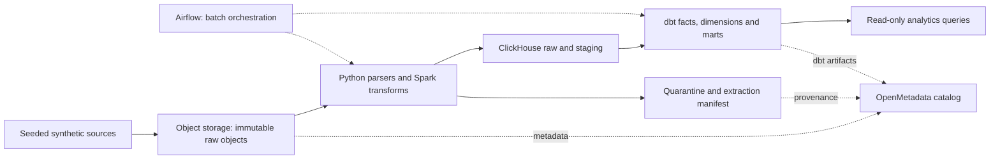

# Capstone: Automotive Data Platform Lab

Đây là đặc tả sẽ triển khai theo [lộ trình 8 tuần](vinfast-8-week-plan.md), không
phải hệ thống đã chạy. Tất cả dữ liệu được tạo giả lập; tên dự án không hàm ý
đây là kiến trúc hoặc dữ liệu nội bộ của VinFast.

## Yêu cầu nghiệp vụ và phạm vi

Phục vụ ba câu hỏi: mỗi xe đi bao nhiêu km mỗi ngày; dealer có bao nhiêu yêu cầu
dịch vụ và mất bao lâu để hoàn tất; tài liệu/log nào liên quan đến mã lỗi và sự
kiện của xe. Làm rõ timezone, đơn vị đo, xử lý bản cập nhật/hủy và phân quyền
trước khi xây model. `distance_delta_km` là quãng đường của event, không cộng
trực tiếp các số đo odometer tích lũy.

Mục tiêu lab ban đầu: batch tối đa 15 phút, mart freshness không quá 30 phút;
các mốc này là yêu cầu giả lập để đo và thảo luận, không phải SLA VinFast.
Fixture nhỏ phải có kết quả đối chiếu chính xác; benchmark cỡ lớn chỉ để so sánh
trên cùng cấu hình, không suy ra capacity production từ máy M1.

Các batch có seed cố định: bắt đầu 10 nghìn events + khoảng 20 file unstructured;
sau khi đúng và đủ tài nguyên mới tăng lên khoảng 1 triệu events + 100 file.
Ghi số hàng, kích thước byte, phân bố key và độ lệch; con số hàng riêng lẻ không
chứng minh khả năng xử lý “at scale”. Kiến trúc đọc streaming/bounded batches,
giới hạn kích thước và tránh gom cả dataset vào RAM phải được thể hiện trong code.

## Luồng dữ liệu

Object storage raw lưu file gốc và manifest ingestion; ClickHouse raw lưu các
record đã parse cùng provenance. Staging chuẩn hóa kiểu dữ liệu, thời gian,
dedup và quarantine; marts thể hiện grain nghiệp vụ. Spark xử lý khối lượng/
shuffle cần thiết; dbt quản lý biến đổi SQL/model/test/docs. Ghi rõ bước thuộc
Spark hay dbt để tránh hai nơi cùng định nghĩa một metric.

## Contracts và grain

| Dataset | Grain / keys | Nội dung và lỗi cần mô phỏng |
|---|---|---|
| Telemetry | Một event logical theo `event_id`, nhiều version tại raw | vehicle, event_time UTC, ingested_at, version, distance delta, fault code; duplicates, late events, correction, skew |
| Dealer history | Một dealer hoặc quan hệ vehicle–dealer trong khoảng hiệu lực `[valid_from, valid_to)` | surrogate key, business key, timezone; đổi dealer, bản ghi đến muộn và khoảng thời gian chồng nhau |
| Service order | Một order theo `order_id`, cập nhật có version | dealer, vehicle, opened/closed time, status; reopen/cancel và null closed time |
| Asset manifest | Một phiên bản object nguồn | object URI/key/version hoặc immutable copy ID, checksum, MIME, byte size, event/ingestion time, owner, classification, related event/order |
| Extracted asset | Một asset version × extractor version × chunk/page nếu có | text/attributes, status, error code, schema version, provenance; không dùng mỗi object key làm định danh |
| `fact_vehicle_event` | Một version hợp lệ hiện hành của event logical | test uniqueness ở lớp đọc chuẩn, không dựa vào unique constraint không có |
| `fact_service_order` | Một trạng thái hiện hành mỗi order | quy tắc reopen/cancel và metric duration được ghi rõ |
| `mart_vehicle_daily` | Một vehicle × UTC date | số event và tổng distance theo quy tắc version/dedup |
| `mart_dealer_service_daily` | Một dealer × business date đã định nghĩa | counts/status/duration; không trung bình các trung bình khi aggregate |

SCD2 có ít nhất một dimension/quan hệ có lịch sử; fact join theo event time,
không luôn gắn về bản current. Late corrections phải có test xác định đúng
các khoảng hiệu lực và fact bị ảnh hưởng. Pin strategy dbt phù hợp với adapter;
không giả định mọi strategy hoặc snapshot đều hỗ trợ như trên warehouse khác.

Telemetry cập nhật phải giữ logical key/sorting key và routing ổn định. Shard key
được chọn bằng workload, cardinality và skew; test cố tình routing sai để chứng
minh vì sao version nằm ở shard khác không tự biến mất khi local merge. Không
coi ReplacingMergeTree hoặc `FINAL` là bảo đảm exactly-once cho cả pipeline.
Tách kết quả đúng ở query-time khỏi việc physical duplicates đã được merge.

## Unstructured tối thiểu và phần mở rộng

| Modality | Bài bắt buộc | Mở rộng khi còn thời gian |
|---|---|---|
| Logs/text | Parse timestamp/severity/fault code và giữ text; malformed lines vào quarantine | schema drift và nhiều log formats |
| Documents | Một PDF có text: extract pages/text, gắn page/chunk về object version | OCR PDF scan; ghi rõ parser text-only không xử lý scan |
| Images | MIME thực, dimensions, metadata được phép; query theo asset/event | OCR hoặc phân loại ảnh, không huấn luyện model |
| Audio | Codec, sample rate, duration và metadata từ file | Local ASR cho một clip ngắn có kiểm tra transcript |
| Video | Codec, duration, resolution/frame rate từ file | Keyframes hoặc transcript và offset thời gian |

Metadata-only cho audio/video chưa phải kinh nghiệm speech/vision extraction ở
quy mô lớn. Báo cáo trung thực khoảng trống này khi ứng tuyển. Embeddings/vector
search chỉ thêm sau khi các cửa correctness bắt buộc đã đạt; không thay nhiệm vụ
chuẩn hóa, lineage, privacy bằng một demo RAG.

Có fixture valid/corrupt cho từng modality; giới hạn kích thước/thời gian parse,
không chạy nội dung file, quarantine có mã lỗi và đường dẫn truy vết. Manifest
phân biệt `pending/succeeded/failed`, checksum không được coi là bằng chứng quyền
sở hữu. Nếu extraction là bất định thì pin cấu hình/model và xác định mức sai
số cho phép. EXIF và transcript có thể chứa dữ liệu cá nhân: phân loại và hạn
chế xuất hiện trong mart/log công khai.

## Nghiệm thu có thể review

| ID | Tình huống | Evidence bắt buộc |
|---|---|---|
| AC01 | Luồng S3 → raw → staging → mart | Lệnh chạy, config version và reconciliation counts/sums với fixture có expected result độc lập |
| AC02 | 2 shard × 1 replica | So sánh query 1/2 shard; duplicate/late version và join có key lệch shard; explain/metrics và lý do chọn keys |
| AC03 | Incremental/dbt/SCD2 | Full vs incremental/replay/backfill cho cùng kết quả trên fixture; uniqueness, not-null, relationship, non-overlap và boundary-time tests |
| AC04 | Airflow/Spark failure | Kill sau partial write; retry hoàn tất với mart không đổi sai; checkpoint chỉ phản ánh dữ liệu commit; log task attempt và Spark metrics |
| AC05 | Unstructured | Fixture valid/corrupt mỗi modality; query nội dung log/PDF và metadata media; rerun cùng version và đổi extractor version có assertions |
| AC06 | DQ/ownership | Freshness/completeness/validity có threshold, owner và hành động; inject bad data khiến check fail/quarantine đúng, không chỉ có test luôn xanh |
| AC07 | Catalog/lineage | Ingest metadata và dbt artifacts thật; query/export chứng minh source → extracted/staging → mart. Bổ sung mapping/API nếu connector không tự suy ra unstructured lineage; ghi phần tự động/manual |
| AC08 | Security/erasure | Deny thử bằng analyst role; inventory đối tượng giả lập; xóa raw versions/derivatives/tables rồi truy vấn kiểm tra; restore drill áp lại deletion ledger trước khi phục vụ |
| AC09 | Promotion/rollback | Dev/staging/prod giả lập cùng code, config riêng; tests trước merge, approval trước promotion; thử rollback một schema change và ghi preconditions/khả năng phục hồi |
| AC10 | Reproducibility | Fresh checkout theo hướng dẫn Linux/macOS; version pins, seed, expected output; ghi OS/architecture thực sự chạy, thời gian/RAM/disk và phần chưa xác minh |
| AC11 | Communication | Demo 15 phút, PR/ADR/runbook tiếng Anh, trình bày trade-off không dùng AI; dẫn evidence thay cho khẳng định chung chung |

Xóa dữ liệu: delete marker trên S3 versioned bucket chưa tương đương xóa các
phiên bản; delete request trên ClickHouse chưa tự chứng minh mọi replica/mutation
đã hoàn tất. Theo dõi trạng thái và xác minh kết quả theo engine/version đang
dùng. Lập inventory cả raw, extracted files, quarantine, tables, logs/cache và
backup nếu có. Với backup bất biến, mô tả retention và cơ chế áp deletion ledger
trước phục hồi; không cam kết xóa vật lý tức thì. Lab mô phỏng workflow, không
phải chứng nhận tuân thủ GDPR.

Lab 2×1 chứng minh sharding, không chứng minh replication/failover. Drill mất
shard bắt buộc quan sát kết quả thiếu/lỗi, phát hiện và phục hồi; không chấp nhận
partial result mà gọi là đúng. RTO/RPO ghi giá trị đo được và giả định. Nếu làm
thêm 2×2 + Keeper, chạy riêng failover/replica lag và ghi topology thực tế.

## Delivery và evidence trong repo

Mỗi thay đổi là PR nhỏ, có tests trước merge và tài liệu theo `AGENTS.md`.
Các tên dưới đây là backlog dự kiến; chỉ PR kế hoạch hiện tại tồn tại, không coi
các PR triển khai đã được mở hoặc code đã có:

1. Baseline + requirements/contracts + setup compatibility matrix.
2. Seed generator + typed ingestion + vertical slice.
3. ClickHouse 2-shard schema + correctness fixtures + ADR.
4. dbt facts/dimensions/SCD2/incremental + model docs.
5. Airflow/Spark orchestration + failure/backfill tests.
6. Unstructured parsers/manifest + metadata mart.
7. Catalog/governance/erasure + runbooks.
8. Environment promotion/CI/recovery + final evidence/demo.

Tách tiếp nếu diff quá lớn để review; một tuần không bắt buộc tương ứng đúng
một PR. Cấu trúc triển khai dự kiến: `src/`, `tests/`, `dags/`, `dbt/`, `infra/`,
`configs/`, `docs/adr/`, `docs/runbooks/`, `docs/learning/evidence/`. Khi có tool
setup, thêm hướng dẫn install/use/update/uninstall/troubleshooting Linux/macOS.

Evidence mỗi tuần gồm commit SHA, command, version/config, dataset seed/size,
expected/actual result, thời gian và resource usage, failure injected, phần chưa
chạy. Commit fixture nhỏ, logs đã loại thông tin nhạy cảm và scripts tạo dữ liệu;
không commit dataset lớn, volumes, secrets, recordings hoặc CV. Binary evidence
lớn dùng artifact có mô tả cách tái tạo và retention; không để bằng chứng cốt lõi
chỉ còn trong artifact hết hạn.

## Kịch bản demo cuối 15 phút

3 phút requirements/architecture/keys; 4 phút pipeline + model queries; 3 phút
inject duplicate/late data/retry và đối chiếu; 3 phút catalog/erasure/recovery
evidence; 2 phút trade-offs, chi phí và giới hạn. Có thể dùng evidence đã ghi cho
drill dài, nhưng phân biệt rõ demo trực tiếp với kết quả đã chạy trước đó.
